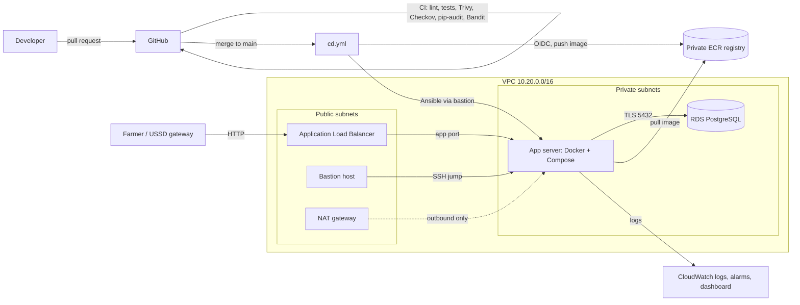

# SokoPrice

> **Know the market price before you sell.**
> Crop price tracking for Rwandan smallholder farmers, accessible from any phone via USSD or a simple web API.

[](https://github.com/jessewalu/sokoprice-formative1/actions/workflows/ci.yml)
[](https://github.com/jessewalu/sokoprice-formative1/actions/workflows/publish.yml)

> ## Live application and demo
>
> | | |
> |---|---|
> | **Live app (AWS)** | [http://sokoprice-dev-alb-1817405499.eu-north-1.elb.amazonaws.com](http://sokoprice-dev-alb-1817405499.eu-north-1.elb.amazonaws.com) |
> | Health check | [/health](http://sokoprice-dev-alb-1817405499.eu-north-1.elb.amazonaws.com/health) (`{"status":"ok"}`) |
> | Crop prices | [/api/prices/maize](http://sokoprice-dev-alb-1817405499.eu-north-1.elb.amazonaws.com/api/prices/maize) |
> | Best market to sell | [/api/best-market/beans](http://sokoprice-dev-alb-1817405499.eu-north-1.elb.amazonaws.com/api/best-market/beans) |
> | Statistics (reads the database) | [/api/stats](http://sokoprice-dev-alb-1817405499.eu-north-1.elb.amazonaws.com/api/stats) |
> | **Video demo (YouTube)** | [https://www.youtube.com/watch?v=hLlKliP6FPI](https://www.youtube.com/watch?v=hLlKliP6FPI) |
> | Project history | [CHANGELOG.md](CHANGELOG.md) (Formative 1, 2, 3 and the Summative) |
>
> The app is an API and USSD service with no web page, so open the links above. The environment is created by Terraform and is only running while we keep it deployed (it is billed by the hour). If a link does not answer, see [section 20](#20-operations-manual) to rebuild it, or watch the video, which shows the whole pipeline working.

## At a glance: what we built

SokoPrice was built in four stages. Each stage adds to the one before it, and everything is in this repository.

| Stage | What was delivered | Where to look |
|-------|--------------------|---------------|
| **Formative 1** | The application: crop price service, REST API, 2-level USSD menu, tests, GitHub project board, branch protection | Sections 1 to 5, 12 |
| **Formative 2** | Docker (multi-stage, non-root), Docker Compose with PostgreSQL, CI pipeline (lint, tests, build, smoke test), image publishing | Sections 6 to 9 |
| **Formative 3** | Terraform (first AWS server), Ansible (Docker, firewall, SSH hardening), DevSecOps scans (pip-audit, Bandit, Trivy, Checkov), `SECURITY.md`, Dependabot | Sections 16 to 18, [`SECURITY.md`](SECURITY.md) |
| **Summative** | Complete pipeline: private network, private server, bastion, managed RDS database, private ECR registry, load balancer, CloudWatch monitoring, and a CD workflow that deploys automatically on merge to `main` | Sections 15 to 21 |

**Summative requirements, and where each is met**

| Requirement | Where it is met |
|-------------|-----------------|
| Modular Terraform in `terraform/` | 8 modules in [`terraform/modules/`](terraform/modules) ([section 16](#16-infrastructure-as-code-terraform)) |
| Private network (VPC) | `modules/network`: public and private subnets, NAT gateway |
| VM in a **private** subnet | `modules/compute`: the application server has no public IP |
| **Bastion host** in a public subnet | `modules/compute`: the only way to reach the private server by SSH |
| **Managed database** | `modules/database`: Amazon RDS PostgreSQL, encrypted, TLS enforced |
| All **security groups** | `modules/security`: load balancer, bastion, app and database, chained |
| **Private container registry** | `modules/registry`: Amazon ECR |
| Ansible installs Docker and Docker Compose | [`ansible/`](ansible/README.md), role `docker` ([section 17](#17-configuration-management-ansible)) |
| **Container image scan** that fails on critical findings | Trivy in `ci.yml` and again in `cd.yml` before the push ([section 18](#18-devsecops-security-scanning)) |
| **IaC scan** | Checkov on Terraform, Dockerfile, workflows, Ansible and secrets ([section 18](#18-devsecops-security-scanning)) |
| `cd.yml` runs only on merge to `main` | [`.github/workflows/cd.yml`](.github/workflows/cd.yml) ([section 19](#19-continuous-deployment-cd)) |
| CD runs all CI checks first | `ci` job reuses `ci.yml` |
| Build, push to the private registry | `build-and-push` job (ECR) |
| Authenticate to the cloud and run Ansible on the VM | `deploy` job: OIDC login, Ansible through the bastion |
| **Live app on a public URL** | Load balancer address at the top of this file |
| README as an operations manual with architecture diagram | [Sections 15 and 20](#15-architecture) |
| `CHANGELOG.md` for Formative 1, 2 and Summative | [CHANGELOG.md](CHANGELOG.md) |
| Video demo | [YouTube](https://www.youtube.com/watch?v=hLlKliP6FPI) |

**Contents:** [At a glance](#at-a-glance-what-we-built) · [Problem](#1-problem-statement) · [Users](#2-target-users) · [Features](#3-core-features) · [Stack](#4-technology-stack) · [Run locally](#5-how-to-run-the-app) · [Docker](#6-containerisation-with-docker) · [Docker Compose](#7-docker-compose) · [CI pipeline](#8-continuous-integration-github-actions) · [Branch protection](#9-branch-protection-and-collaboration-evidence) · [Structure](#10-project-structure) · [Security](#11-security-practices-shift-left) · [Project management](#12-project-management) · [Contributing](#13-contributing) · [Team](#14-team) · [Architecture](#15-architecture) · [Terraform](#16-infrastructure-as-code-terraform) · [Ansible](#17-configuration-management-ansible) · [DevSecOps](#18-devsecops-security-scanning) · [CD pipeline](#19-continuous-deployment-cd) · [Operations manual](#20-operations-manual) · [Evidence and demo](#21-evidence-and-demo-video) · [Limitations and future work](#22-known-limitations-and-future-work) · [License](#23-license)

---

## 1. Problem Statement

Smallholder farmers in Rwanda and across East Africa often sell their harvest without knowing what the crop is worth in nearby markets. Price information is held by middlemen, so farmers frequently accept low prices and lose income. Most farmers use **feature phones without internet access**, so web-only or smartphone-only apps do not reach them.

**SokoPrice** closes this information gap by letting farmers (and buyers) check current market prices for common crops in major markets, and see which market offers the best price, using a USSD menu that works on any phone, plus a REST API that other apps can build on.

## 2. Target Users

| User | Need |
|------|------|
| **Smallholder farmers** | Decide where and when to sell, and avoid being underpaid by middlemen |
| **Small traders / buyers** | Find the cheapest market to buy from |
| **Cooperatives & extension officers** | Share reliable price data with members |
| **Developers / NGOs** | Integrate price data into other tools via the API |

## 3. Core Features

1. **Crop price lookup**: view the per-kg price of a crop in every tracked market.
2. **Best-market-to-sell finder**: shows the market paying the highest price for a crop.
3. **Cheapest-market-to-buy finder**: shows the lowest-priced market for buyers.
4. **USSD menu (2 levels)**: feature-phone friendly navigation (Africa's Talking compatible).
5. **REST API**: JSON endpoints for crops, prices, best markets and request statistics, plus a `/health` check used by Docker and CI.
6. **Optional PostgreSQL request log**: every USSD menu path is stored (no phone numbers, no personal data) so the team can see which crops farmers ask about most. The app works without the database.
7. **Production deployment on AWS**: the same app runs behind a load balancer on a private server with a managed database, deployed automatically by the CD pipeline (sections 15 to 20).

*Planned (backlog):* prices stored in PostgreSQL, price submission by market agents, price-change SMS alerts, Kinyarwanda language support. *(Terraform cloud deployment is delivered: see sections 15 to 20.)*

## 4. Technology Stack

| Layer | Technology |
|-------|-----------|
| Language | Python 3.12 (CI also tests 3.11) |
| Framework | Flask 3 |
| Production server | Gunicorn |
| Data | `data/prices.json` for prices; PostgreSQL 16 for the USSD request log |
| Testing | pytest + pytest-cov (80% coverage gate) |
| Linting | Ruff |
| Containerisation | Docker (multi-stage, non-root) and Docker Compose |
| CI/CD | GitHub Actions: CI (lint, test, Docker build and smoke test, security scans) and CD (build, scan, push to ECR, deploy with Ansible) |
| Cloud / IaC | Terraform on AWS (`eu-north-1`): VPC, EC2 (`t3.micro`), RDS PostgreSQL 16 (`db.t3.micro`), ECR, Application Load Balancer, NAT gateway, Secrets Manager, KMS, IAM OIDC |
| Configuration management | Ansible (roles `common`, `docker`, `security`, `app`) |
| Security scanning | pip-audit, Bandit, Trivy, Checkov, ansible-lint, Dependabot |
| Observability | CloudWatch Logs (container logs), metric alarms, dashboard, SNS alerts, VPC flow logs |
| USSD gateway (planned) | Africa's Talking |

---

## 5. How to Run the App

### Prerequisites
- Git
- **Docker Desktop / Docker Engine with the Compose plugin** (for Options B and C), or
- Python 3.11+ (3.12 recommended) (for Option A)

### Option A: Run locally (no Docker)

```bash
# 1. Clone the repository
git clone https://github.com/jessewalu/sokoprice-formative1.git
cd sokoprice-formative1

# 2. Create and activate a virtual environment
python -m venv .venv
source .venv/bin/activate        # Windows: .venv\Scripts\activate

# 3. Install dependencies (add -dev for tests and linting)
pip install -r requirements-dev.txt

# 4. (Optional) set up environment variables
cp .env.example .env             # Windows: copy .env.example .env

# 5. Start the app
python run.py
```

The app runs at **http://localhost:5000**. With `DATABASE_URL` unset the database features are simply disabled.

### Option B: Run with Docker Compose (recommended)

One command starts the app **and** PostgreSQL:

```bash
cp .env.example .env             # optional: change passwords/ports (Windows: copy)
docker compose up --build
```

Open **http://localhost:5000/health**. Details are in [section 7](#7-docker-compose).

### Option C: Run only the container

```bash
docker build -t sokoprice .
docker run --rm -p 5000:5000 sokoprice
```

### Try it out

**REST API**
```bash
curl http://localhost:5000/health
curl http://localhost:5000/api/crops
curl http://localhost:5000/api/prices/maize
curl http://localhost:5000/api/best-market/beans
curl http://localhost:5000/api/stats
```

| Method | Endpoint | Description |
|--------|----------|-------------|
| GET | `/` | Service name and endpoint list |
| GET | `/health` | Liveness check (`{"status": "ok"}`) |
| GET | `/api/crops` | Tracked crops and markets |
| GET | `/api/prices/<crop>` | Per-market prices (404 for unknown crop) |
| GET | `/api/best-market/<crop>` | Best market to sell and cheapest to buy |
| GET | `/api/stats` | Request-log status and USSD request count |
| POST | `/ussd` | USSD gateway endpoint (form field `text`) |

Example response for `/api/prices/maize`:
```json
{
  "crop": "maize",
  "currency": "RWF",
  "unit": "kg",
  "updated": "2026-10-20",
  "prices": {"Kimironko": 450, "Nyabugogo": 420, "Musanze": 400}
}
```

**USSD simulation** (mimics what the USSD gateway sends)
```bash
# Dial: main menu
curl -X POST http://localhost:5000/ussd -d "text="

# Option 1 (check price) -> list of crops
curl -X POST http://localhost:5000/ussd -d "text=1"

# Option 1 -> crop 3 (Maize) -> prices in all markets
curl -X POST http://localhost:5000/ussd -d "text=1*3"

# Option 2 (best market to sell) -> crop 1 (Beans)
curl -X POST http://localhost:5000/ussd -d "text=2*1"
```

> On Windows PowerShell use `curl.exe` instead of `curl`.

**USSD menu flow**
```
Welcome to SokoPrice
1. Check crop price      -> [select crop] -> prices per market
2. Best market to sell   -> [select crop] -> best market + price
3. Cheapest market to buy-> [select crop] -> cheapest market + price
0. Exit
```

### Run the tests and the linter

```bash
pip install -r requirements-dev.txt
ruff check .                                   # lint (must report no errors)
pytest -q --cov=app --cov-fail-under=80        # tests + coverage gate
```

The PostgreSQL integration test is skipped unless `TEST_DATABASE_URL` is set (CI sets it automatically). To run it locally against the Compose database, start `docker compose up -d db`, temporarily publish its port, and export the URL.

---

## 6. Containerisation with Docker

The [`Dockerfile`](Dockerfile) is a **multi-stage build**:

| Stage | Purpose |
|-------|---------|
| `builder` | Creates a virtual environment and installs `requirements.txt` (layer-cached: only re-runs when requirements change) |
| `runtime` | Copies only the virtual environment and app code into a clean `python:3.12-slim-bookworm` image |

Best practices applied (each instruction is commented in the file):

- **Pinned base image** (`python:3.12-slim-bookworm`), never `latest`.
- **Non-root user**: a system user `appuser` (UID/GID 10001) with no shell and no home directory; the container runs as that user.
- **Layer caching**: `requirements.txt` is copied and installed before the application code.
- **Small image and context**: slim base, no build tools in the final image, and a [`.dockerignore`](.dockerignore) that keeps `.git`, `.env`, tests, docs and caches out of the build.
- **Health check**: `HEALTHCHECK` runs `scripts/healthcheck.py`, which calls `/health` using only the standard library (slim images have no `curl`).
- **Production server**: Gunicorn (2 workers) runs as PID 1 via `exec`, so it receives `SIGTERM` for clean shutdowns.
- **Configuration through environment variables** (`PORT`, `DATABASE_URL`, `FLASK_DEBUG`); no secrets are baked into the image.
- **OCI labels** with title, description, source and license.

Useful commands:

```bash
docker build -t sokoprice .                 # build
docker run --rm -p 5000:5000 sokoprice      # run
docker ps                                   # STATUS shows "(healthy)" after a few seconds
docker exec <container> id                  # prints uid=10001(appuser): proves non-root
```

## 7. Docker Compose

[`docker-compose.yml`](docker-compose.yml) runs the whole stack with a single command.

```bash
docker compose up --build        # build and start app + database
docker compose up -d --wait      # start in the background and wait until healthy
docker compose logs -f app       # follow application logs
docker compose down              # stop, KEEP database data
docker compose down -v           # stop and DELETE database data (named volume)
```

| Service | Image | Role |
|---------|-------|------|
| `app` | built from `./Dockerfile` (`runtime` stage) | Flask API + USSD service on gunicorn, published on `localhost:${APP_PORT:-5000}` |
| `db` | `postgres:16-alpine` | Stores the USSD request log; **no published port** |

How the requirements are met:

- **Networking**: two networks. `frontend` connects the app to the host (published port). `backend` is `internal: true` and connects only `app` and `db`, so the database is unreachable from outside. The app reaches Postgres at the hostname `db`.
- **Persistence**: the named volume `pgdata` stores `/var/lib/postgresql/data`, so data survives `docker compose down` and rebuilds.
- **Environment variables**: every value has a safe development default and can be overridden through a `.env` file (copy [`.env.example`](.env.example)). `.env` is git-ignored.
- **Start-up order**: `app` waits for `db` to be healthy (`depends_on: condition: service_healthy`).
- **Health checks and restarts**: both services have health checks and `restart: unless-stopped`.
- **Hardening**: `init: true`, `read_only: true` root filesystem with a `tmpfs` for `/tmp`, `cap_drop: ALL`, `no-new-privileges`, and log rotation.

| Variable | Default | Meaning |
|----------|---------|---------|
| `APP_PORT` | `5000` | Host port the app is published on |
| `FLASK_DEBUG` | `0` | Flask debug mode (keep off) |
| `POSTGRES_DB` | `sokoprice` | Database name |
| `POSTGRES_USER` | `sokoprice` | Database user |
| `POSTGRES_PASSWORD` | `sokoprice_dev_password` | Database password (**change for anything shared**) |

Verify the stack end to end:

```bash
docker compose up -d --build --wait
curl http://localhost:5000/health
curl -X POST http://localhost:5000/ussd -d "text=1*3"
curl http://localhost:5000/api/stats       # {"database":"connected","ussd_requests":1}
docker compose down -v
```

**Troubleshooting**

| Problem | Fix |
|---------|-----|
| `port is already allocated` | Set `APP_PORT=5001` in `.env` |
| `/api/stats` shows `unavailable` | Database still starting or wrong password; run `docker compose logs db` |
| Changed `POSTGRES_PASSWORD` but login fails | The old volume keeps the old password; run `docker compose down -v` |

---

## 8. Continuous Integration (GitHub Actions)

Workflow: [`.github/workflows/ci.yml`](.github/workflows/ci.yml)

**Triggers**

- `push` to **any branch except `main`**
- `pull_request` **targeting `main`**

The workflow can also be called by another workflow (`workflow_call`): [`cd.yml`](.github/workflows/cd.yml) reuses it so the same checks run again before a deployment. Superseded runs on the same ref are cancelled (`concurrency`), and the workflow has read-only `contents` permission (least privilege).

**Jobs**

```
 lint ──┐
        ├──> docker-build
 test ──┘   (needs lint and test)
 (py3.11, py3.12)

 dependency-scan · sast-scan · container-scan · iac-scan · iac-validate
 (security and infrastructure checks, run in parallel; see section 18)
```

| Job | What it does | Fails when |
|-----|--------------|------------|
| `lint` | Checkout, set up Python 3.12 (pip cache), install dependencies, `ruff check .` | Ruff reports any error |
| `test (py3.11)` / `test (py3.12)` | Matrix over two Python versions with a real PostgreSQL 16 service container; runs `pytest --cov=app --cov-fail-under=80`; uploads `test-results.xml` and `coverage.xml` as artifacts | A test fails, coverage is under 80%, or a dependency cannot be installed |
| `docker-build` | Builds the image with Buildx and GitHub Actions layer cache, smoke-tests the container (waits for `healthy`, calls `/health`, `/api/prices/maize`, `/ussd`), then validates and runs the full Compose stack and checks `/api/stats` reports `connected` | The image fails to build, the container is not healthy, any request fails, or Compose cannot start |
| `dependency-scan` | `pip-audit` on `requirements.txt` | Any known vulnerability |
| `sast-scan` | Bandit on the application code | Medium or high severity finding |
| `container-scan` | Builds the image and scans it with Trivy | Fixable HIGH or CRITICAL vulnerability |
| `iac-scan` | Checkov on Terraform, Dockerfile, workflows, Ansible and secrets | Any failed check |
| `iac-validate` | `terraform fmt -check`, `terraform validate`, `ansible-lint`, playbook syntax check | Formatting, syntax or lint error |

`docker-build` only starts after `lint` and `test` pass, and any failing step fails the whole pipeline.

**Publishing:** [`.github/workflows/publish.yml`](.github/workflows/publish.yml) runs on every push to `main` (i.e. after a PR is merged). It builds the image and pushes it to GitHub Container Registry as `ghcr.io/jessewalu/sokoprice-formative1:latest` and `:sha-<short>`, authenticating with the automatic `GITHUB_TOKEN` (no stored credentials).

**Reproduce CI locally**

```bash
ruff check .
pytest -q --cov=app --cov-fail-under=80
docker build --target runtime -t sokoprice-app:local .
docker compose up -d --wait && curl --fail http://localhost:5000/health && docker compose down -v
```

## 9. Branch Protection and Collaboration Evidence

### Branch protection on `main`

Settings → Branches → rule for `main`:

| Rule | Why it matters |
|------|----------------|
| Require a pull request before merging | No one pushes directly to `main`; every change is visible and discussed |
| Require 1 approval (Code owners review) | A second pair of eyes catches bugs; [`CODEOWNERS`](.github/CODEOWNERS) assigns reviewers |
| Dismiss stale approvals on new commits | An approval only counts for the code that was actually reviewed |
| **Require status checks to pass:** `lint`, `test (py3.11)`, `test (py3.12)`, `docker-build`, `dependency-scan (pip-audit)`, `sast-scan (Bandit)`, `container-scan (Trivy)`, `iac-scan (Checkov)`, `iac-validate (Terraform + Ansible)` | Broken, unlinted or un-buildable code cannot be merged |
| Require branches to be up to date | Changes are tested against the latest `main` |
| Require conversation resolution | Review comments cannot be ignored |
| Include administrators | The rules apply to everyone, with no exceptions |

> The status check names must match the job names above exactly. Because `test` uses a matrix, GitHub lists it as `test (py3.11)` and `test (py3.12)`.

### CI evidence

Links to real runs and pull requests (fill in the URLs from the Actions and Pull requests tabs):

| Evidence | Requirement | Link |
|----------|-------------|------|
| Successful run #1 | ≥ 3 successful runs | https://github.com/jessewalu/sokoprice-formative1/actions/runs/41121356911 |
| Successful run #2 | | https://github.com/jessewalu/sokoprice-formative1/actions/runs/41044648209 |
| Successful run #3 | | https://github.com/jessewalu/sokoprice-formative1/actions/runs/41121607373 |
| Failed run (lint or test) | ≥ 1 failed run | https://github.com/jessewalu/sokoprice-formative1/actions/runs/41034821146 |
| Fix that turned it green | failed run then fixed | https://github.com/jessewalu/sokoprice-formative1/actions/runs/41121356911 |
| Pull request with CI checks and review | ≥ 1 PR with review | https://github.com/jessewalu/sokoprice-formative1/pull/16 |
| Summative pull request (`summative` into `main`) | Summative merge | https://github.com/jessewalu/sokoprice-formative1/pull/50 |
| Summative CD run (build, scan, push to ECR, deploy) | Continuous deployment | https://github.com/jessewalu/sokoprice-formative1/actions/runs/44946298078 |
| Branch protection screenshot | Required checks enabled | `docs/screenshots/branch-protection.png` |

### Team collaboration

- Work is done on branches and merged through pull requests reviewed by a different teammate.
- Contribution tracking sheet: https://docs.google.com/spreadsheets/d/1k8UOI845SVSR8oId_86h8xpJYibwzxaeQ3t5jsGJFbw/edit?usp=sharing
- Planning and status live on the GitHub Projects board (see section 12).

---

## 10. Project Structure

```
sokoprice-formative1/
├── app/
│   ├── __init__.py          # Flask app factory + REST endpoints
│   ├── prices.py            # Price logic (best/cheapest market), no web code
│   ├── ussd.py              # USSD menu state machine, no web code
│   └── db.py                # Optional PostgreSQL USSD request log
├── data/prices.json         # Sample price dataset
├── scripts/healthcheck.py   # Container health probe (stdlib only)
├── tests/
│   ├── test_app.py          # REST API + USSD endpoint tests
│   ├── test_healthcheck.py  # Health probe tests
│   ├── test_db.py           # Request-log tests (Postgres test runs in CI)
│   ├── test_prices.py       # Price logic unit tests
│   └── test_ussd.py         # USSD menu unit tests
├── docs/
│   ├── PROJECT_BOARD.md     # GitHub Projects backlog, user stories, status
│   ├── F2_EVIDENCE_GUIDE.md, F3_EVIDENCE_GUIDE.md, SUMMATIVE_GUIDE.md   # Evidence and submission guides
│   └── screenshots/         # Evidence screenshots
├── .github/
│   ├── workflows/ci.yml       # CI: lint, test (matrix), Docker build, security scans, IaC checks
│   ├── dependabot.yml         # Weekly dependency update pull requests
│   ├── workflows/publish.yml  # Push image to GHCR after merge to main
│   ├── workflows/cd.yml       # Continuous deployment to AWS on merge to main (section 19)
│   └── CODEOWNERS             # Required reviewers
├── terraform/               # Infrastructure as Code (section 16)
│   ├── main.tf, variables.tf, outputs.tf, versions.tf
│   ├── terraform.tfvars.example, backend.tf.example
│   ├── environments/        # dev and prod settings examples
│   └── modules/
│       ├── network/         # VPC, public/private subnets, NAT gateway, flow logs
│       ├── security/        # Security groups: load balancer, bastion, app, database
│       ├── compute/         # Bastion host (public) and app server (private)
│       ├── database/        # RDS PostgreSQL, KMS key, Secrets Manager
│       ├── registry/        # Private ECR repository
│       ├── loadbalancer/    # Application Load Balancer and target group
│       ├── cicd/            # GitHub OIDC provider and deploy role
│       └── monitoring/      # CloudWatch logs, alarms, dashboard, SNS
├── ansible/                 # Server configuration and deployment (section 17)
│   ├── site.yml             # Playbook: bastion play and app server play
│   ├── inventory/           # production.yml (pipeline), hosts.ini, aws_ec2.yml
│   ├── group_vars/          # Settings, Vault example, ProxyCommand through the bastion
│   └── roles/               # common, docker, security, app
├── SECURITY.md              # Scan results, remediation, accepted risks (section 18)
├── CHANGELOG.md             # History: Formative 1, 2, 3 and Summative
├── requirements-security.txt # Pinned security scanners
├── Dockerfile               # Multi-stage, non-root, health check, gunicorn
├── docker-compose.yml       # App + PostgreSQL, networks, volume, health checks
├── .dockerignore            # Keeps the build context small and secret-free
├── requirements.txt         # Runtime dependencies (installed in the image)
├── requirements-dev.txt     # + pytest, pytest-cov, ruff
├── ruff.toml                # Lint rules
├── pytest.ini
├── .env.example             # Template for secrets (real .env is git-ignored)
├── .gitignore
├── LICENSE                  # MIT
└── run.py                   # Entry point
```

## 11. Security Practices ("shift left")

- Comprehensive `.gitignore` excluding secrets (`.env`, keys, credentials), IDE files, dependencies and build artifacts/logs.
- Configuration is read from **environment variables**; only `.env.example` (placeholders) is committed.
- Docker image runs as a **non-root user** (UID 10001); Compose adds a read-only filesystem, dropped capabilities and `no-new-privileges`.
- The database is on an **internal network** with no published port.
- Debug mode is **off by default**.
- The USSD log stores only the menu path, **never phone numbers**.
- CI uses least-privilege `permissions`, and image publishing uses the short-lived `GITHUB_TOKEN`.
- `main` is protected by branch protection rules (section 9).
- Five automated security and infrastructure scans run on every pull request (section 18); findings and accepted risks are documented in [`SECURITY.md`](SECURITY.md).
- **In the cloud (Summative):** the application server and the database are in **private subnets** with no public address; the only public components are the load balancer and the bastion host. Security groups are chained (internet to load balancer to app to database), disks, database, registry and logs are encrypted, the database enforces TLS, the database password is generated by Terraform and kept in AWS Secrets Manager, and instances require IMDSv2.
- **No stored cloud keys:** GitHub Actions signs in to AWS with short-lived OpenID Connect (OIDC) credentials. The deploy role can only be assumed by this repository and can only touch one registry, one secret and one security group.
- Images are scanned with Trivy before they are pushed, and registry tags are immutable (the tag is the commit SHA).

## 12. Project Management

Work is tracked on our GitHub Projects Kanban board (Backlog / In Progress / Done) with user stories, acceptance criteria, labels, assignees and milestones. The full backlog, current status and acceptance criteria are documented in [`docs/PROJECT_BOARD.md`](docs/PROJECT_BOARD.md) (36 items across Formatives 1 to 3 and the Summative). Per-member tasks, deadlines and meeting notes are in the team contribution sheet (section 14).

## 13. Contributing

1. Create a branch from `main` (`feature/<name>` or `fix/<name>`). CI runs on every push.
2. Commit with clear messages (`feat:`, `fix:`, `docs:`, `build:`, `test:`).
3. Run `ruff check .` and `pytest -q` locally before pushing.
4. Open a pull request into `main`, linked to its issue (e.g. `Closes #5`).
5. Wait for green checks (`lint`, `test`, `docker-build`, and the security checks) and one teammate's approval, resolve all review conversations, then merge.

## 14. Team

| Name | GitHub | Role | Summative contribution |
|------|--------|------|------------------------|
| Jesse Walusansa | [@jessewalu](https://github.com/jessewalu) | Backend & DevOps (CI/CD), team lead | Terraform infrastructure (all eight modules), AWS deployment, GitHub OIDC and pipeline setup, live deployment and troubleshooting |
| Karabo Ojiambo | [@Karabo-jpg](https://github.com/Karabo-jpg) | Testing, Docker & Documentation | Ansible playbook and roles (Docker, firewall, SSH hardening, deployment, rollback), inventories, CI update, operations documentation |
| K. Koita | [@Kkadi20](https://github.com/Kkadi20) | Repository security & Project management | CD workflow (`cd.yml`), security review and `SECURITY.md`, GitHub environment and branch-protection checks, project board |

Team contribution sheet: https://docs.google.com/spreadsheets/d/1k8UOI845SVSR8oId_86h8xpJYibwzxaeQ3t5jsGJFbw/edit?usp=sharing

## 15. Architecture

The Summative delivers a complete DevOps pipeline: code is reviewed, tested and scanned, then built, pushed to a private registry and deployed to a private server, with no manual step after the merge.



| Layer | Component | Where |
|-------|-----------|-------|
| Network | VPC, public and private subnets, NAT gateway | `terraform/modules/network` |
| Firewalls | Security groups chained ALB → app → database; bastion from admin IP only | `terraform/modules/security` |
| Compute | Bastion (public subnet), app server (**private** subnet) | `terraform/modules/compute` |
| Data | Amazon RDS PostgreSQL, encrypted, TLS, password in Secrets Manager | `terraform/modules/database` |
| Registry | Private Amazon ECR | `terraform/modules/registry` |
| Entry point | Application Load Balancer (public URL) | `terraform/modules/loadbalancer` |
| Pipeline identity | GitHub OIDC role (no stored AWS keys) | `terraform/modules/cicd` |
| Observability | CloudWatch logs, alarms, dashboard, SNS alerts | `terraform/modules/monitoring` |
| Configuration | Docker, Compose, firewall, SSH hardening, deploy | `ansible/` |
| Automation | CI (`ci.yml`) and CD (`cd.yml`) | `.github/workflows/` |

**How a request travels:** internet → load balancer (public subnets, port 80) → application server (private subnet) → RDS database (private subnet, TLS). **How an administrator or the pipeline gets in:** only through the bastion host with an SSH key; the server and database accept no connection from the internet.

| Item | Value (dev environment) |
|------|-------------------------|
| Region | `eu-north-1` (Stockholm) |
| Network | VPC `10.20.0.0/16`, two public subnets, two private subnets, one NAT gateway |
| Servers | Ubuntu EC2 `t3.micro`: bastion (public subnet, Elastic IP) and app server (private subnet) |
| Database | RDS PostgreSQL 16, `db.t3.micro`, 20 GB, encrypted, 1-day backups |
| Registry | ECR repository `sokoprice/app` (immutable tags, scan on push) |
| Entry point | Application Load Balancer, HTTP on port 80, health check on `/health` |
| Pipeline identity | IAM role `sokoprice-dev-github-deploy` (OIDC) |
| Monitoring | CloudWatch log group `/sokoprice/dev/app`, dashboard `sokoprice-dev-overview`, six alarms |

## 16. Infrastructure as Code (Terraform)

The infrastructure is defined in [`terraform/`](terraform/README.md) as **eight modules** (`network`, `security`, `compute`, `database`, `registry`, `loadbalancer`, `cicd`, `monitoring`). It creates a private network, an application server in a **private subnet**, a **bastion host** in a public subnet, a managed **RDS** database, all security groups and a private **ECR** registry, and exposes the app through a load balancer. Inputs are validated variables (no secrets, no hard-coded region), providers are pinned and every resource is tagged.

```bash
cd terraform
cp terraform.tfvars.example terraform.tfvars    # set your IP /32 and your public SSH key
terraform init
terraform plan -out=tfplan
terraform apply tfplan
terraform output app_url
```

Useful outputs after `terraform apply`: `app_url` (the live address), `ecr_repository_url`, `bastion_public_ip`, `ssh_bastion_command`, `ssh_app_command`, `db_endpoint`, `db_password_command`, `dashboard_name`, `github_cli_commands` (sets every GitHub variable for the pipeline) and `ansible_inventory`. Two environment examples are provided: [`dev.tfvars.example`](terraform/environments/dev.tfvars.example) (cheap, easy to destroy) and [`prod.tfvars.example`](terraform/environments/prod.tfvars.example) (Multi-AZ database, deletion protection, longer backups).

Full instructions, variables, security design and costs: [`terraform/README.md`](terraform/README.md).

## 17. Configuration Management (Ansible)

The playbook in [`ansible/`](ansible/README.md) configures the servers Terraform created. It reaches the private app server **through the bastion**, installs **Docker and Docker Compose**, applies firewall (UFW) and SSH hardening, logs in to the private registry, pulls the new image and runs `docker compose up -d`, then checks the public URL. It has four roles (`common`, `docker`, `security`, `app`), is idempotent, rolls back to the previous image if the new one is unhealthy, and ships container logs to CloudWatch.

```bash
cd ansible
pip install -r requirements.txt && ansible-galaxy collection install -r requirements.yml
ansible-playbook site.yml --private-key ~/.ssh/sokoprice --ask-vault-pass
```

In normal operation you do not run this yourself: the CD pipeline does (section 19). Manual steps: [`ansible/README.md`](ansible/README.md).

## 18. DevSecOps (Security Scanning)

Security checks run in GitHub Actions on **every pull request** and again before every deployment:

| Scan type | Tool | Threshold |
|-----------|------|-----------|
| Dependency scan | pip-audit | Any known vulnerability |
| Static code analysis | Bandit | Medium or higher |
| **Container image scan** | **Trivy** | **Fixable HIGH or CRITICAL fails the build** (in CI and again in CD before the push) |
| **Infrastructure-as-Code scan** | **Checkov** (Terraform, Dockerfile, workflows, Ansible, secrets) | **Any failed check fails the build** |
| IaC quality | `terraform fmt/validate`, `ansible-lint` (production profile) | Any error |

[`SECURITY.md`](SECURITY.md) documents the findings, how each was fixed, the accepted risks with the reason, and the security controls. Dependabot opens weekly update pull requests. Run the scans locally with `pip install -r requirements-security.txt`.

## 19. Continuous Deployment (CD)

[`.github/workflows/cd.yml`](.github/workflows/cd.yml) runs **only when code is merged to `main`**:

| Stage | What happens | Stops the pipeline if |
|-------|--------------|-----------------------|
| 1. `ci` | Runs every CI job again: lint, tests, dependency, SAST, container, IaC scans, Terraform and Ansible validation | any check fails |
| 2. `build-and-push` | Authenticates to AWS with **OIDC** (no stored keys), builds the image, **scans it with Trivy**, pushes it to the private **ECR** registry tagged with the commit SHA | a fixable HIGH/CRITICAL vulnerability is found |
| 3. `deploy` | Fetches a short-lived registry token and the database password (masked), opens the bastion for the runner's own IP for the duration of the run, runs **Ansible through the bastion**: log in to ECR, pull the new image, `docker compose up -d`, check `/health` on the live URL; then closes the bastion again | the new version is not healthy (it is rolled back and the run fails) |

Safeguards: least-privilege permissions, one deployment at a time (`concurrency`), the AWS role can only be assumed from `main` of this repository, and the temporary SSH rule and key file are removed even when the run fails (`if: always()`).

**Result:** the first CD run after the merge is the evidence for this stage: [CD run](https://github.com/jessewalu/sokoprice-formative1/actions/runs/44946298078). It stopped at the AWS login because GitHub now sends the repository in an immutable form (`owner@id/repo@id`) that the first version of the role did not trust. We fixed the role's trust policy (see [CHANGELOG.md](CHANGELOG.md) and the troubleshooting table below), re-ran the workflow, and all three jobs passed.

The older [`publish.yml`](.github/workflows/publish.yml) (public GitHub Container Registry image) is kept as the Formative 2 deliverable; the production deployment uses the private ECR image from `cd.yml`.

## 20. Operations manual

### 20.1 First-time setup (once)

**You need:** Terraform, the AWS CLI configured with a user that can create the resources (`aws configure`), the GitHub CLI (`gh auth login`, as a repository admin), Git Bash or Linux, and an SSH key pair (`ssh-keygen -t ed25519 -f ~/.ssh/sokoprice -N ""`). On Windows use **Git Bash** for these commands (Ansible, if you run it by hand, needs WSL). If a path starting with `/` is mangled by Git Bash, put `MSYS_NO_PATHCONV=1` in front of the command.

1. Create the infrastructure: `terraform apply` (section 16). Takes 10 to 15 minutes. Use `terraform plan -out=tfplan` and apply that exact file; if you change any file, make a new plan.
2. Connect GitHub to AWS (the only secret is the SSH key):

```bash
terraform -chdir=terraform output -raw github_cli_commands | bash
gh secret set DEPLOY_SSH_PRIVATE_KEY < ~/.ssh/sokoprice
```

3. In GitHub: **Settings → Environments → New environment** named `production` (optionally require a reviewer), and add all nine CI checks as required status checks on the `main` branch protection rule: `lint`, `test (py3.11)`, `test (py3.12)`, `docker-build`, `dependency-scan (pip-audit)`, `sast-scan (Bandit)`, `container-scan (Trivy)`, `iac-scan (Checkov)` and `iac-validate (Terraform + Ansible)`. Do not add the CD jobs: they only run after a merge.
4. Merge a pull request to `main`. The CD workflow builds, pushes and deploys. Open `terraform output app_url`.

### 20.2 Deploy a change

Open a pull request, wait for green checks, get a review, merge. That is all: CD does the rest. The image tag is the commit SHA, so every running version can be traced to a commit.

### 20.3 Roll back

- **Automatic:** if a new version does not become healthy, the playbook restarts the previous image and the run fails.
- **Manual:** find the last good commit in the **Actions** tab and re-run its `CD` workflow (or revert the commit and merge the revert).

### 20.4 Look at the application

| Need | How |
|------|-----|
| Live check | `curl "$(terraform -chdir=terraform output -raw app_url)/health"` |
| Logs | CloudWatch Logs, group `terraform output app_log_group_name`; or SSH to the server (`terraform output ssh_app_command`) and run `cd /opt/sokoprice && docker compose logs --tail 100` |
| Metrics and alarms | CloudWatch dashboard `terraform output dashboard_name`; six alarms (server CPU, server status check, unhealthy targets, 5xx errors, database CPU, database storage) notify the SNS topic (set `alert_email` to receive them) |
| Database password | `terraform output -raw db_password_command` shows the command that reads it from Secrets Manager |

### 20.5 Troubleshooting

| Symptom | Likely cause and fix |
|---------|----------------------|
| CD fails at `Authenticate to AWS` | Repository variables missing or wrong (`AWS_ROLE_ARN`), or the run is not on `main` |
| CD fails opening the bastion | `BASTION_SG_ID` wrong, or the role lacks permission: re-run `terraform apply` |
| Ansible cannot connect | Secret `DEPLOY_SSH_PRIVATE_KEY` is not the private half of the key given to Terraform; `BASTION_HOST` changed after a rebuild (re-run `github_cli_commands`) |
| Load balancer returns 502/503 | No healthy container yet: check the deploy job, then `docker compose logs` on the server |
| CD fails with `Not authorized to perform sts:AssumeRoleWithWebIdentity` | The role's trust policy does not match what GitHub sends. Check the token subject with `gh api repos/<owner>/<repo>/actions/oidc/customization/sub`; the role trusts both `repo:<owner>/<repo>` and the immutable `owner@id/repo@id` forms, for `main` and for the `production` environment. Re-apply Terraform and re-run |
| `terraform apply tfplan` says the plan is stale or the lock file is inconsistent | The plan was made from older code or state. Delete `tfplan`, run `terraform init -upgrade`, make a new plan |
| `terraform apply` fails because old resources already exist | An earlier stack (for example Formative 3) is still deployed: run `terraform destroy` with that code first |
| `gh: command not found` in Git Bash after installing | Close and reopen Git Bash, or add the install folder (`C:\Program Files\GitHub CLI`) to the PATH in `~/.bashrc` |
| A GitHub variable such as `APP_LOG_GROUP` shows `C:/Program Files/Git/...` | Git Bash rewrote a leading `/`. Set it again with `MSYS_NO_PATHCONV=1 gh variable set ...` |
| Trivy fails the build | A fixable HIGH/CRITICAL vulnerability: update the base image or package (Dependabot usually opens that PR) |
| App starts but `/api/stats` fails | Database unreachable: check `DB_HOST`, the database security group, and that the password in Secrets Manager matches |

### 20.6 Tear down (important: it costs money while running)

```bash
terraform -chdir=terraform destroy
```

Then delete the IAM access key used for Terraform. The load balancer, NAT gateway and database are billed by the hour (roughly 3 to 4 US dollars per day together; check the AWS pricing pages). In the dev settings a destroy leaves nothing behind; the production settings protect the registry and database.

### 20.7 Secrets and what must never be committed

Never commit `terraform.tfvars`, `tfplan`, `.terraform/`, `terraform.tfstate`, `ansible/group_vars/all/vault.yml`, SSH private keys or AWS access keys (all are in `.gitignore`). The database password is generated by Terraform and kept in AWS Secrets Manager; the pipeline reads it at run time and masks it in the logs. The only GitHub secret is `DEPLOY_SSH_PRIVATE_KEY`; everything else is a non-secret repository variable.

## 21. Evidence and demo video

**Video demo:** [https://www.youtube.com/watch?v=hLlKliP6FPI](https://www.youtube.com/watch?v=hLlKliP6FPI). It walks through the three stages (application, containers and CI, infrastructure and security) and the finished Summative pipeline.

| Evidence | Where |
|----------|-------|
| Live application | [Load balancer address](http://sokoprice-dev-alb-1817405499.eu-north-1.elb.amazonaws.com/health) |
| Summative pull request | https://github.com/jessewalu/sokoprice-formative1/pull/50 |
| CD run (CI, build and scan, push to ECR, deploy) | https://github.com/jessewalu/sokoprice-formative1/actions/runs/44946298078 |
| CI runs and pull requests with reviews (Formatives 1 and 2) | Section 9 |
| Scan findings, fixes and accepted risks | [`SECURITY.md`](SECURITY.md) |
| What changed in each stage | [`CHANGELOG.md`](CHANGELOG.md) |
| Evidence and submission guides | [`docs/F2_EVIDENCE_GUIDE.md`](docs/F2_EVIDENCE_GUIDE.md), [`docs/F3_EVIDENCE_GUIDE.md`](docs/F3_EVIDENCE_GUIDE.md), [`docs/SUMMATIVE_GUIDE.md`](docs/SUMMATIVE_GUIDE.md) |
| Task allocation and meeting log | Team contribution sheet (section 14) |

## 22. Known limitations and future work

These are deliberate, documented trade-offs for a course project; each accepted risk is explained in [`SECURITY.md`](SECURITY.md).

- The public address uses **HTTP**, not HTTPS, because we have no domain name or certificate. The HTTPS listener and redirect are already in the Terraform code and switch on when `certificate_arn` is set.
- No web application firewall and no load balancer access logs.
- One NAT gateway and one application server, and the dev database is single-zone (the production settings turn on Multi-AZ and deletion protection).
- The database password is generated once and not rotated automatically.
- The app connects to the database with encryption (`sslmode=require`) but does not verify the server certificate.
- The price data is a JSON file; planned: prices in PostgreSQL, price submission by market agents, SMS alerts, Kinyarwanda, and a real USSD gateway (Africa's Talking).

## 23. License

Released under the [MIT License](LICENSE).
